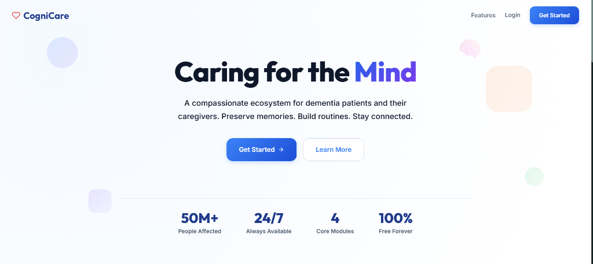

# 🧠 CogniCare — Cognitive Health & Dementia Care Ecosystem

> A compassionate, AI-powered ecosystem designed for dementia and cognitive impairment patients and their caregivers. Preserve precious memories, structure daily routines, and maintain continuous, real-time connectivity.

[](https://cognicare-sigma.vercel.app/)
[](https://react.dev/)
[](https://nodejs.org/)
[](https://expressjs.com/)
[](https://www.mongodb.com/)
[](https://ai.google.dev/)
[](https://socket.io/)

---

### 🌐 Live Application
👉 **Access CogniCare Live:** [https://cognicare-sigma.vercel.app/](https://cognicare-sigma.vercel.app/)

---



---

## 📌 Overview

Worldwide, over **50 million people** live with dementia, creating immense daily challenges for patients and their support networks. **CogniCare** is built to alleviate this burden by bridging cognitive stimulation with supportive caregiver oversight.

The platform provides a dual-sided experience:
1. **For Patients**: A warm, accessible interface providing memory prompts, gentle voice/text conversation with an AI companion, and predictable day-to-day routine schedules.
2. **For Caregivers**: A real-time control console to track medication adherence, view wellness logs, receive status alerts, and coordinate care seamlessly.

---

## ✨ Core Features & Modules

### 1. 🤖 AI Cognitive Companion (Powered by Google Gemini)
* Context-aware conversational AI tuned for empathy, memory jogging, and non-confrontational cognitive stimulation.
* Retains conversational history to provide continuity across sessions.

### 2. 📸 Memory Vault (GridFS Multimedia Storage)
* Interactive digital memory bank preserving personal histories, family photographs, and voice memos.
* Backed by **MongoDB GridFS** for efficient streaming of large image and audio files.

### 3. ⏰ Routine & Daily Habit Builder
* Automated reminders for critical routines: medication dosage, hydration, cognitive exercises, and meals.
* Real-time completion logs visible immediately to linked caregivers.

### 4. 💬 Real-Time Caregiver-Patient Chat (Socket.io)
* Instant, low-latency messaging between patients and caregivers.
* Emergency check-in pings and automated notifications powered by WebSockets.

### 5. 📊 Wellness & Mood Analytics
* Daily emotional and cognitive trend tracking visualized with **Recharts**.
* Helps caregivers and medical consultants observe patterns and cognitive changes over time.

---

## 🛠️ Tech Stack & Architecture

```text
┌─────────────────────────────────┐         Socket.io / HTTP REST         ┌─────────────────────────────────┐
│       React 19 Frontend         │ <===================================> │      Express 5 / Node.js        │
│  (Recharts, React-Router-DOM)   │                                       │   (Mongoose, Socket.io, JWT)    │
└─────────────────────────────────┘                                       └────────────────┬────────────────┘
                                                                                           │
                                              ┌────────────────────────────────────────────┴─────────────────┐
                                              ▼                                                              ▼
                                   ┌──────────────────────┐                                       ┌──────────────────────┐
                                   │  Google Gemini API   │                                       │   MongoDB & GridFS   │
                                   │ (Generative AI SDK)  │                                       │  (Documents & Media) │
                                   └──────────────────────┘                                       └──────────────────────┘
```

| Component | Technologies |
| :--- | :--- |
| **Frontend** | React 19, Vite, React Router DOM 7, Axios, Recharts, React Icons |
| **Backend** | Node.js, Express 5, Socket.io, Express Async Handler |
| **AI / NLP** | Google Generative AI SDK (`@google/generative-ai` Gemini) |
| **Database & Storage**| MongoDB, Mongoose 9, GridFS (`gridfs-stream`, `multer-gridfs-storage`) |
| **Security & Auth** | JWT (JSON Web Tokens), bcryptjs password hashing |
| **Deployment** | Vercel (Frontend), Cloud Web Service (Backend) |

---

## 📂 Project Structure

```text
cognicare/
├── client/                      # React 19 Single Page Application
│   ├── src/
│   │   ├── components/          # Reusable UI components, modals & navigation
│   │   ├── pages/               # Landing, Companion, MemoryVault, Routines, Dashboard
│   │   ├── services/            # Axios API wrappers & Socket.io listeners
│   │   └── App.jsx
│   ├── package.json
│   └── vite.config.js
├── server/                      # Express 5 REST & WebSocket Backend
│   ├── config/                  # Database (db.js) & GridFS configurations
│   ├── controllers/             # Auth, Companion, Memory, Routine, Message controllers
│   ├── models/                  # Mongoose schemas (User, Memory, Routine, DailyLog)
│   ├── routes/                  # Express API routers
│   ├── services/                # Google Gemini AI & Socket.io service handlers
│   ├── middleware/              # JWT auth and error handling middlewares
│   ├── server.js                # Application entrypoint
│   └── package.json
└── README.md                    # Project documentation
```

---

## 🚀 Local Development Setup

### Prerequisites
- **Node.js** (v18+) and **npm**
- **MongoDB** instance (local or MongoDB Atlas connection URI)
- **Google Gemini API Key** (obtainable from [Google AI Studio](https://aistudio.google.com/))

---

### 1. Clone the Repository
```bash
git clone https://github.com/kumarrishi4981/cognicare.git
cd cognicare
```

### 2. Configure Backend (`server/`)
1. Navigate to the server folder:
   ```bash
   cd server
   npm install
   ```
2. Create a `.env` file in `server/` with the following keys:
   ```env
   PORT=5000
   MONGO_URI=your_mongodb_connection_string
   JWT_SECRET=your_jwt_secret_key
   GEMINI_API_KEY=your_gemini_api_key
   CLIENT_URL=http://localhost:5173
   ```
3. Start the backend:
   ```bash
   npm run dev
   ```
   * The server will run on `http://localhost:5000`.

---

### 3. Configure Frontend (`client/`)
In a separate terminal:
```bash
cd client
npm install
```
Start the Vite development server:
```bash
npm run dev
```
* Open your browser at `http://localhost:5173`.

---

## ☁️ Deployment Guide

- **Frontend**: Configured for instant deployment on **Vercel** with client-side SPA routing.
- **Backend**: Can be hosted on **Render**, **Railway**, or **Koyeb** as a Node.js web service with `MONGO_URI` and `GEMINI_API_KEY` environment variables configured.

---

## 🤝 Contributing
Contributions, feature enhancements, and healthcare feedback are welcome!
1. Fork the Project
2. Create a Feature Branch (`git checkout -b feature/MemoryJournal`)
3. Commit your Changes (`git commit -m 'feat: Add audio memory transcription'`)
4. Push to the Branch (`git push origin feature/MemoryJournal`)
5. Open a Pull Request

---

## 📄 License
This project is open-source under the **ISC / MIT License**.

---

## 👤 Author
- **Rishi Kumar**
- GitHub: [@kumarrishi4981](https://github.com/kumarrishi4981)
- Live App: [CogniCare on Vercel](https://cognicare-sigma.vercel.app/)
